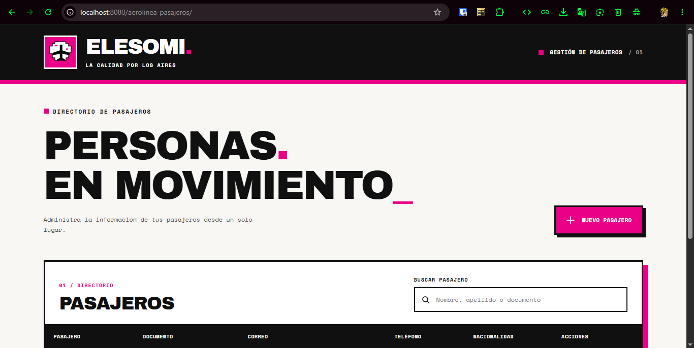
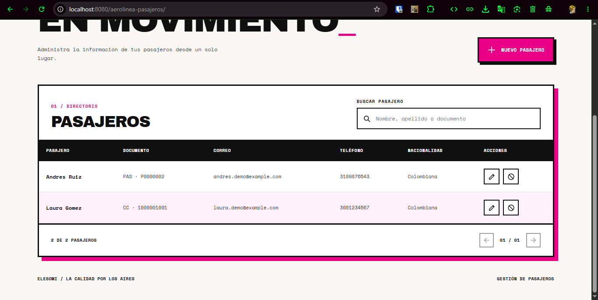
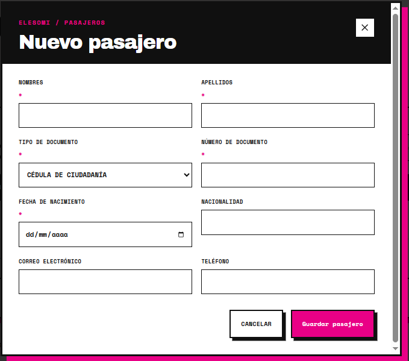
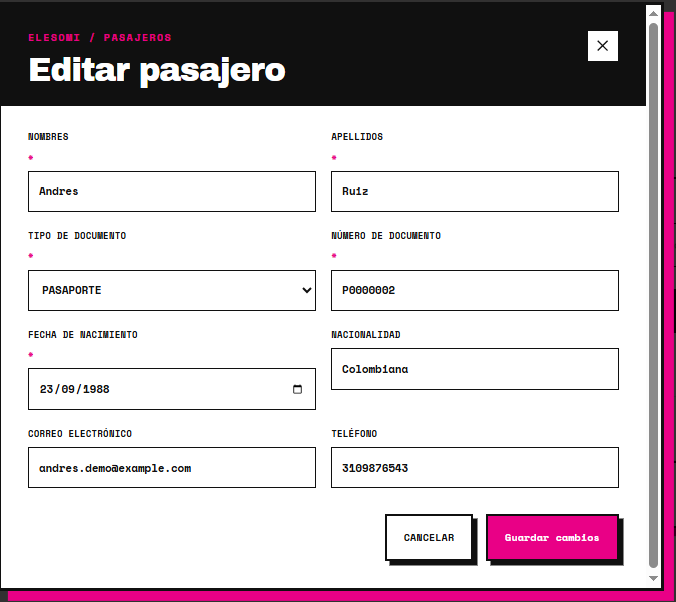
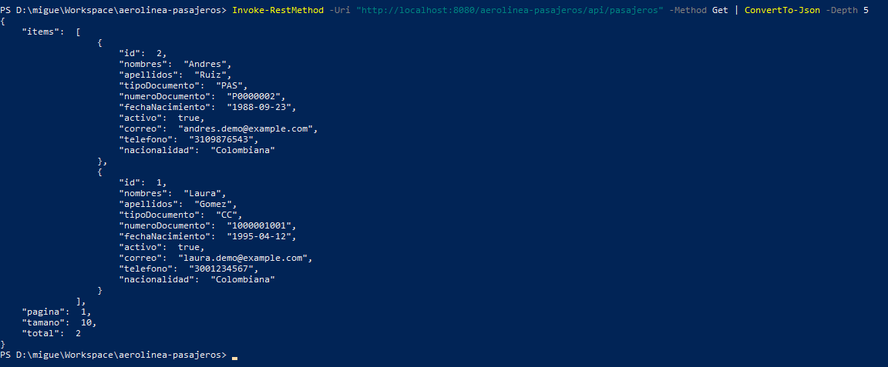
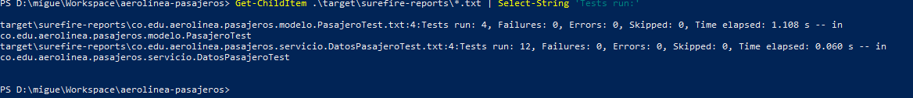

# ELESOMI - Evidencias de ejecución

**La calidad por los aires**

**Módulo:** Gestión de Pasajeros

**Equipo:** Elena Vargas Grisales, Sofía Vásquez Espinal y Miguel Ángel Marín Otálvaro

**Fecha de ejecución:** 24 de noviembre de 2026

Las siguientes evidencias corresponden a capturas de pantalla realizadas durante la ejecución local de ELESOMI con Payara Server y PostgreSQL.

## Pantalla de inicio ELESOMI
Inicio de la aplicación desplegada en Payara.

## Directorio de pasajeros
Listado paginado y acciones de gestión de pasajeros.

## Registro de pasajeros
Formulario de alta desde la interfaz web.

## Edición de pasajeros
Formulario de modificación de información.

## Consulta de API REST
Consulta HTTP GET y respuesta JSON de dos pasajeros activos.

## Pruebas automatizadas JUnit
16 pruebas ejecutadas, sin fallos, errores ni omisiones.

## Alcance de la comprobación

Se observaron la aplicación y sus formularios, la respuesta de consulta REST y la ejecución de pruebas JUnit. Las capturas no constituyen una prueba de integración con los módulos desarrollados por otros grupos.
